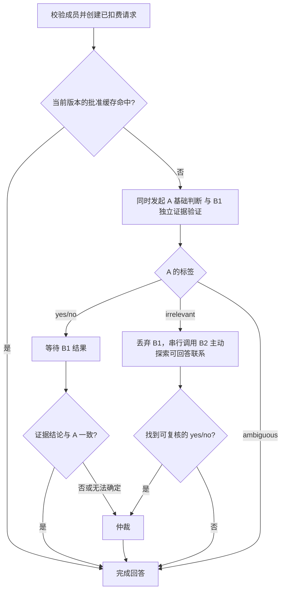

# Ask 分支验证实施计划

日期：2026-10-13。状态：仅规划，未修改运行代码、数据库或线上配置。

## 1. 目标与已确认规则

将当前“严格／推断双路并发，分歧后仲裁”改为“A 基础判断 → 按 A 的标签选择 B 验证任务 → 必要时仲裁”。

已确认：

- A 输出 `yes / no / irrelevant / ambiguous`。
- A 为 yes/no 时进入 B1。B1 只验证完整命题的证据，不验证主线相关性。
- B1 不收到 A 的标签或理由，独立给出支持、反驳或无法确定；由程序比较。
- A 为 irrelevant 时进入 B2，主动寻找被遗漏的、有依据且有助于理解真相的联系。
- B2 也不收到 A 的标签或理由；任务类型由程序选择。任务路由本身可能透露倾向，因此这是定向复核，不宣称完全独立或盲测。
- A 与 B1 同时发起（2026-10-13 确认）：B1 在 A 结果出来前已开始，因此 B1 与 A 完全独立；A 为 irrelevant 时再串行调用 B2，A 为 ambiguous 时丢弃 B1 结果。
- B1 发现证据与 A 一致即可保留 yes/no，即使该事实不属于主线。证据不足或冲突由仲裁兜底。
- “与此无关”允许涵盖信息不足，以及与真相主线没有实质关联的细节；不强求所有已知非主线细节都返回同一种标签。
- `key_points` 是推理评分标准。新 ask 应使用汤底和独立 Facts 证据层，不继续把评分点作为权威事实库。
- Facts 可用自然语言编写和审阅；内部存储格式不要求管理员手写 JSON。

以下具体字段、缓存门槛、失败策略和发布步骤是本计划的实施建议，不代表已经交付。

## 2. 当前实现与需要替换的部分

当前入口：网页 `src/app/rooms/[code]/ask/route.ts`，共用执行器 `src/lib/room-ai-runner.ts`，模型逻辑 `src/lib/deepseek.ts`，缓存 `src/lib/qa-cache.ts`。CLI 入口 `src/app/api/v1/player/[...path]/route.ts` 已与网页共用同一执行器；切换时需确认两个入口都跟随同一个引擎开关。

目前先通过 RPC 验证成员、扣费并创建 pending 请求；随后查询当前题目的已批准缓存。未命中时用同一提供方并发执行 strict/inferential，标签一致直接采用，不一致再仲裁。现有仲裁只收到两路标签，不收到理由。

目前 ask 将 `key_points` 注入为 Authoritative implicit facts。双路一致的 yes/no 可生成共享事实和待审批缓存；单路降级、仲裁及 GLM fallback 结果不进入这两项。

新方案需替换双路调度、prompt、内部审计和缓存准入；沿用现有成员验证、扣费、房间互斥、题目隔离、租期、完成及退款事务。每个玩家请求只扣一次费用，不随 A/B/仲裁调用次数追加扣费。

## 3. 流程与决定表

| A | B 的有效结果 | 程序动作 |
| --- | --- | --- |
| yes | B1 supported | 保留 yes |
| yes | B1 rejected / undetermined | 仲裁 |
| no | B1 rejected | 保留 no |
| no | B1 supported / undetermined | 仲裁 |
| irrelevant | B2 recoverable，携带 yes/no 与证据 | 仲裁，不直接覆盖 A |
| irrelevant | B2 nonessential / insufficient | 保留 irrelevant |
| ambiguous | 不调用 B（第一版建议） | 直接返回 ambiguous |

超时、无效 JSON、引用不存在等属于调用失败，不得伪装成 undetermined、insufficient 或“验证通过”。

## 4. 各模块合同

### A：基础判断

输入汤面、汤底、当前版本已批准 Facts、适用的本题 examples、最近最多 5 条玩家正式询问及当前问题。历史仅用于指代，不提供历史主持标签，不把玩家猜测当成事实。

先判断能否形成单一是非命题，再判断证据与主线联系。unknown 不等于 no；客观事实、人物认知、他人陈述必须区分。允许有依据的多步推断，禁止新增故事设定。

建议内部输出 `answer_type`、完整命题摘要和简短理由。A 为 irrelevant 时可附内部 `irrelevant_reason: insufficient_evidence / nonessential`，供审计统计，不传给 B2，不影响路由。

### B1：证据验证

输入当前问题、同题历史玩家问题、汤面、完整汤底及已批准 Facts；不接收 A 的标签、理由或命题改写，防止沿用 A 的误读。第一版不提供问答 examples，避免把标准答案当成独立证据。

输出建议：

- `verdict: supported / rejected / undetermined`。
- 自己识别的完整命题。
- 证据引用：汤底原文片段或有效 Fact ID。
- 简短推导步骤及缺失前提。

supported 表示完整命题得到支持；rejected 必须有与完整命题矛盾的证据；缺少信息只能是 undetermined。**不要求填写或判断主线相关性。** 如发现问题根本无法归为明确命题，标记输入解释问题并转仲裁，不硬判真伪。

### B2：联系探索

输入与 B1 相同，不接收 A 的结果。任务是积极探索问题与真相解释之间可确认的联系，而非证明某个既定答案。

建议输出：

- `recoverable`：找到与真相解释相关、且完整原命题可明确支持或反驳的证据链；必须附 yes/no、引用及推导。
- `nonessential`：未发现对真相解释有实质作用的联系；即使某个细节已知，也可保持 irrelevant。
- `insufficient`：存在潜在联系，但完整命题仍缺少证据，或合理推导方向不能形成稳定答案。

仅“可能有关”、某个子命题为真或存在相似关键词，都不构成 recoverable。B2 可扩展寻找证据的范围，不能改变问题的主体、具体原因、认知范围或时间。

“主线”不等于评分点清单：帮助理解人物、事件、线索和因果的事实，即使不计分，也可属于可恢复联系。

### 仲裁：解决冲突

接收原问题、汤面、汤底、批准 Facts、仅用于指代的历史，以及 A 和 B 的结构化结果、引用与理由。先独立核对完整命题，再检查各条证据；A/B 输出均为待核查材料，不是事实。

仲裁可输出四种标签中的任意一种，不要求二选一。B1 的 supported/rejected 与 A 一致时已直接返回；进入仲裁后仍不因“非主线”强制否决一个有充分证据的 yes/no。B2 的 recoverable 必须复核主线联系与完整证据链；不能仅因 B2 找到了联系就改答 yes。

仲裁失败不自动偏向 A 或 B；按失败补偿流程处理。

## 5. Facts 证据层

建议新增私密题目事实表，以便单条审核、版本管理及权限隔离。字段至少包含题目 ID、稳定 Fact ID、自然语言描述、明确／推导类型、汤底原文依据或依赖 Fact ID、审核状态及内容版本。

- 汤底是最高依据；Facts 不能覆盖或补写汤底没有的故事设定。
- AI 生成结果先作为草稿，不直接进入运行 prompt。推导事实须展示完整依据供审核。
- 引用必须属于当前题目和当前批准版本；程序检查引用存在、状态、长度和依赖有效性，循环依赖禁止。
- 原文引用能匹配只证明引用存在，不能证明推理成立；后者仍需审核及模型回归。
- 题目汤底修改后，旧 Facts 标记待复核，不能继续作为已批准依据使用。
- 无已批准 Facts 的题目仍可根据汤面／汤底工作，不自动用 `key_points` 冒充 Facts，也不阻塞整个题库切换。
- 管理端通过题目详情按钮打开事实编辑／审核界面，展示自然语言列表与依据；沿用管理员身份和二次验证，保存与状态更新走服务端管理入口及原子 RPC。

创建表的迁移应显式启用 RLS、按实际调用路径授予最小表权限（含 service_role），公开角色不可直接读取汤底、Facts 草稿或内部依据。函数使用空 search_path、完整 schema 名，撤销 PUBLIC 默认执行权限并仅授权必要角色；多表版本更新在事务中完成。

## 6. Examples、缓存与共享事实

### Examples 兼容

现有 fact/inferential 是旧双路适用标签，不直接重命名为 A/B。第一版建议 A 同时读取经过一致性检查的本题两类 examples；完全等价且答案冲突的示例先标记待审，不让模型自行决定优先级。仅完整语义等价时适用，不把宽泛示例套到新增具体条件的窄问题。

B1/B2 不依赖 examples 进行证据验证；仲裁也以汤底和 Facts 为依据。例库后续调整单独预览和回读验收，不在引擎切换时批量自动改写题库。

### 缓存

- 为新引擎增加版本，并绑定题目内容／Facts／examples 的有效版本。只有版本全部匹配的批准缓存可命中。
- 旧 strict/inferential 缓存保留用于回滚，新引擎不能直接复用旧版本答案。
- 第一版只将“A 为 yes/no 且 B1 证据验证一致”的稳定问题写入 pending，继续保留代词、复合问、低价值等过滤及人工批准。
- 仲裁结果、B2 结果、ambiguous/irrelevant、验证失败或降级结果不写新缓存。
- 当前归一化完全匹配／相似候选加 GLM 严格等价机制可保留；批准缓存命中仍按现有规则计费。

### 房间共享事实

独立 Facts 是题库的私密证据；房间事实面板是玩家已经获得的公开信息，二者不能混用。

第一版只对 B1 一致的 yes/no 或有效批准缓存命中尝试生成房间事实摘要；仲裁结果暂不贡献，以降低误判扩散。GLM 摘要失败可沿用 DeepSeek 回退，摘要失败不影响已经成立的答案。摘要不得泄露问答未确认的额外汤底。

## 7. 故障、时延与审计

A 与 B1 并发，B2 和仲裁串行。各路径时延：

| 路径 | 时延 | 调用数 |
| --- | --- | --- |
| A yes/no，B1 一致 | max(A, B1) | 2 |
| A yes/no，B1 冲突 | max(A, B1) + 仲裁 | 3 |
| A irrelevant | A + B2（+ 仲裁） | 3–4（含被丢弃的 B1） |
| A ambiguous | A | 2（含被丢弃的 B1） |

并发规则：

- A 为 irrelevant/ambiguous 时，B1 的成功、失败或超时都不影响请求结果；可在拿到 A 标签后中止 B1。被丢弃的 B1 结果只作为“未采用”写入审计，用于离线统计，不参与判定。
- A 为 yes/no 而 B1 失败时，按下方“必要验证失败”处理；A 失败时无论 B1 结果如何都视为失败。
- 主要成本在输入。A、B1、B2、仲裁的 prompt 应以完全一致的公共前缀开头（汤面、汤底、已批准 Facts），角色指令、examples、历史和当前问题放在其后，以便同题后续请求命中 DeepSeek 上下文缓存。同一瞬间并发的 A 与 B1 彼此通常无法命中，第一问之后的请求才能受益。
- B1/B2 输出限制为结论、少量引用编号和一两句推导，并设置较小的 `max_tokens`，避免串行路径被长输出拖慢。

分别记录各阶段耗时、调用量和总时延（可复用 deepseek.ts 已有的 `[ai-usage]` 日志，补充 A/B1/B2 用途标签及 B1 是否被采用）；共享总截止时间，预留落库／退款时间。现有 30 秒模型流程预算、请求租期和平台执行时限需要联合检查，不能简单给每步各 30 秒；irrelevant 路径最长，应以它为准估算预算。

建议采用“未完成验证不发布答案”：A/B/仲裁任一步必要调用失败，可在剩余预算允许时按现有开关使用备用提供方重跑完整新流程；预算不足或仍失败则结束请求并退款。不得将网络失败解释为没有证据；备用提供方结果第一版不写缓存或共享事实。

维持同房间 pending 互斥及原有费率。调用前后检查题目版本；处理中题目、Facts 或 examples 发生变化时取消并补偿，避免旧证据写入新版本。晚到响应不得复活已退款／过期请求，不重复发布或重复退款。

新增版本化内部审计结构，记录 A、路由、B1/B2、引用、仲裁、最终标签、提供方、耗时、失败阶段、缓存及题目版本。不要把 B1/B2 塞进名为 strict/inferential 的旧字段，也不要把失败路线复制成成功路线。

管理端消息审计、AI 错误案例、导出／备份需兼容旧记录和新结构；玩家 HTTP、CLI、Realtime、补拉与缓存序列化全部剥离内部理由、证据和路由信息。前端只展示既有四种答案与允许公开的房间事实。

## 8. 实施顺序

1. 固化合同与离线样本：写 A/B1/B2/仲裁 prompt 和结构校验；确认 ambiguous 直返及第一版缓存／失败策略。先完成路由单测，不发真实付费请求。
2. 建立 Facts、版本及缓存隔离迁移：使用 CLI 创建新迁移；审查 grant/RLS/函数签名；本地与 dry-run 检查后再安排部署。不得修改已部署迁移。
3. 实现管理端 Facts 编辑、生成草稿及审核：提供清晰依据与状态，保留现有标签和筛选。用少量题目完成审核样例，暂不批量生成。
4. 实现新引擎：在 deepseek.ts 或独立模块中实现 A→B→仲裁，执行器接入版本隔离、审计、事实及缓存准入；hint/reason 的评分规则与调用行为保持原有范围。
5. 离线回归与受控真实模型对照：固定题目／问题／证据版本，对旧引擎和新引擎分别评分；记录所有失败调用，不只统计成功样本。
6. 开关发布：通过服务端开关选择引擎，默认旧引擎；先受控测试房间，再逐步启用。结合真实流程和时延证据决定扩大范围；保留旧引擎与旧缓存回滚能力。

本次仅交付计划，上述代码、迁移、付费评估、上线及题库写入均未执行。

## 9. 验证与验收

### 必须覆盖的判定场景

- A yes + supported / rejected / undetermined，以及 A no 的三种组合。
- 有据但非主线的 yes/no 经 B1 一致后正常通过，确认 B1 不增加相关性门槛。
- A irrelevant + B2 三类结果；recoverable 的 yes 和 no 均经仲裁复核。
- B2 仅找到相关性、仅支持子命题或新增假设时，不得误报 recoverable。
- 清楚但未知的事实不能判 no；客观事实与人物误解分开；未知认知不能被扩写成“从未相信”。
- 多步因果、直接／间接原因、行为暴露含义、比喻、反讽、开放问、选择问、复合问和未明指代。
- 历史错误主持答案不进入 prompt，历史玩家前提不变成证据；本题历史不会混入旧题。
- examples 窄／宽命题、两类冲突、Fact 引用不存在／跨题／未批准／失效、提示注入。
- A ambiguous 直接返回的误判单独统计；该分支第一版没有 B 兜底，不宣称已解决。

### 工程检查

- 用模拟模型结果测试路由与准入，检查 B 的请求体确实没有 A 标签、理由或改写。
- 并发场景：A irrelevant/ambiguous 时 B1 失败或超时不影响结果；A yes/no 时 B1 失败走失败策略；A 先失败、B1 后返回不得发布答案；被丢弃的 B1 只记审计不参与判定。
- 测试阶段超时、格式错误、空响应、输出截断、备用失败、版本变化、租期过期、重复完成及退款未确认。
- 覆盖网页和 CLI 共用入口、游客／注册用户、座位／个人积分、命中缓存仍扣费、失败补偿、房间互斥。
- 新表权限与管理 RPC 使用预期角色验证；用公开 key 验证应允许的玩家 RPC，并确认不能读私密证据。
- 检查管理员审计与旧消息兼容；玩家 HTTP、CLI、Realtime、补拉及导出边界不泄露证据或内部理由。
- 实施代码后运行 typecheck、lint、build 及对应测试；迁移部署后核对记录、签名和授权，并做真实流程端到端检查。

### 效果指标与启用条件

分别报告 A 初判、B1、B2、仲裁及最终准确率；按路径报告错误修复数、新增错误数、误答 yes/no、漏答可推导命题、ambiguous 误判、超时／降级率、平均调用量及总耗时 P50/P95。B2 另报可恢复联系的误报与漏报，B1 另报 supported/rejected 的证据正确性。

离线样本中所有路由、安全与一致性检查必须通过；模型对照不得只看最终总准确率。受控实测若仍出现证据不足却通过 B1、B2 编造联系、重复扣费／退款、私密证据泄露或持续超出平台预算，应暂停扩大启用并回滚。模型效果与时延数值门槛在基线测量后写入验收报告，不能在尚未测量时声称新方案更准确或更快。

## 10. 第一版建议默认与保留问题

建议默认：A 与 B1 并发、B2 串行；ambiguous 直接返回；无 Facts 可基于汤底运行；B1/B2 不读取问答 examples；仅 B1 验证一致的稳定 yes/no 可申请缓存；仲裁结果不进入共享事实；必要验证失败走备用或退款。

上线前需根据对照结果决定：是否增加 ambiguous 复核、Facts 草稿生成是否使用额外验证模型、是否放宽仲裁答案的事实准入，以及是否需要调整总时限。这里的选择不改变已确认的“B1 不验证相关性”。
