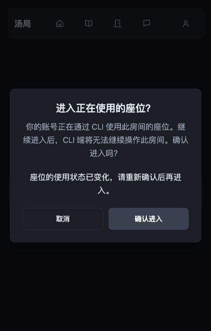
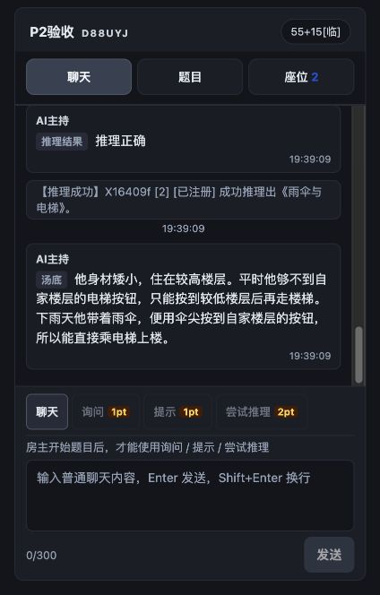

# OnlineSoup CLI P2 验收记录

日期：2026-10-09。状态：网页互通核心实现、Supabase 迁移、Vercel 生产部署、浏览器与独立 Codex 有界游玩通过；Claude/真人混合与数小时连续运行仍待验收，P2 不标记全量完成。

## 实现

大厅为本账号当前房间显示“CLI 使用中”；明确进入被 CLI 占用的座位时显示站内确认弹窗，取消返回大厅且不接管。确认通过 Server Action 提交，仅接受 6 位房间码与 64 位十六进制版本，服务端再次 getUser；不用原生 confirm。

`get_room_takeover_status(text)` 仅返回当前用户座位的 cli_in_use 和不透明 session_version，不返回原始 session_id。版本由私有 HMAC 密钥绑定座位、房间、用户、membership_id、active_session_id、active_session_updated_at。`confirm_cli_room_takeover(text,text)` 先获取既有事务 gate，再锁房间/座位并验证真实 Auth 会话及版本；版本变化返回 SEAT_SESSION_CHANGED，网页重新读取并要求再次确认。若已变为网页会话，用户需再次点击重新进入，不复用旧同意。

旧 take_over_room_session 和 join_room_as_member 也在 gate 内拒绝无确认的 CLI 接管，防止直接调用旧 RPC 绕过 UI；CLI 会话依旧 USE_PLAYER_API。网页之间的接管与游客语义保留。新私有 helper 不向公开角色授权，两项公开 RPC 仅授 authenticated、SECURITY DEFINER 设置空 search_path 并自行鉴权，不增加公开表权限。

部署迁移：`20261009112650_cli_web_takeover_confirmation`，已通过 MCP 应用并以真实线上版本补档；旧迁移未修改。

## 本地证据

- 空白 PostgreSQL 18.4 全量迁移重放成功；Auth/Realtime 替身、pg_cron 排除，不替代生产云端证据。
- P0 26 项 + P1 12 项 + P2 11 项数据库行为通过。P2 覆盖只返回本人不透明版本、旧入口绕过拒绝、缺失/篡改/过期版本、并发只有一胜、网页之间接管、退出重进、其他座位版本、CLI/匿名/私有函数权限、个人积分显式扣款与同来源退款、座位不足不自动扣个人、撤销会话与非成员拒绝。
- CLI 11 项行为、根项目 4 项单测通过；根项目 typecheck、lint（0 错误/3 条旧警告）、build 通过。

## 生产、浏览器与外部 Agent

### 生产发布与权限

- 实现提交 `4e2a0ec`；用该提交的独立 git archive 发布（含当时已提交的网页 UI / sin1 配置），不携带本地 .env.local。
- Vercel 部署 `dpl_CL1Trr72KKNu43GnpYH8tj65MPUr` READY，预览地址 `https://online-soup-6idhnei29-asw0506.vercel.app`，已别名到 `https://onlinesoup.ai0506.com`。本次未推送 GitHub。
- 线上迁移记录、函数签名、空 search_path 和最小授权已回读；新增两个公开 RPC 对 anon 禁用、authenticated 可执行。普通用户使用公开 key 实际验证 CLI 占座状态，以及旧接管/加入入口的拒绝；匿名状态查询被拒绝。

### 真实浏览器

专用临时账号从正式登录页登录，网页操作由本助手通过浏览器完成，不是直接 RPC 代替 UI。

1. 大厅看到“CLI 使用中”，进入后显示站内确认。
2. 点击取消返回大厅；真实 CLI /state 仍成功，座位未被接管。
3. 再次打开确认，CLI 显式 /join --takeover 更新占座版本；网页提交旧版本时显示“座位的使用状态已变化，请重新确认后再进入”，没有进入房间。
4. 再点击确认成功进入，旧 CLI /state 返回 ROOM_DEVICE_IN_USE。
5. 独立网页房主的网页间恢复可直接进入；房主发聊天、外部 CLI 玩家发聊天/询问/推理、主持回答与正式揭底均在浏览器中可见。

### 个人积分与认证恢复

- 生产真实 /ask --use-personal-points 在座位仍有 15 分时成功，paid_from=personal，个人积分减 1、座位余额保持 15。默认座位不足不自动使用个人，以及原来源恰好一次退款由本地 P2 数据库行为覆盖。
- 只在临时 CLI 的本地 Supabase 会话缓存中将过期时间设为已过期，保留真实 JWT/refresh token；下一次真实 /state 触发 Supabase 令牌轮换，refresh token 改变、session_id 不变，新 Cookie 持久化且读取成功。这个受控过期实验不是等待数小时的长期运行测试。
- 随后真实撤销该 CLI Auth 会话；/state 返回 LOGIN_REQUIRED；同账号 /login 成功，普通 /join 返回 ROOM_DEVICE_IN_USE，只有显式 --takeover 恢复座位。测试没有修改任何常用账号。

### 独立外部 Codex 玩家

Codex CLI 0.160.1 在项目之外的空目录启动，使用专用注册账号；仅提供临时 soup MCP 适配器转调真实 CLI，禁用 Shell、浏览器、其他连接器和项目/数据库访问。工具固定账号目录与命令白名单，最多 24 次调用/3 次付费，禁止个人积分和接管。适配器仅供本次测试，未作为产品 MCP Server 发布。

首次尝试因工具需要审批而被 never 策略拒绝，不计为游玩。依据官方 [MCP 配置](https://learn.chatgpt.com/docs/extend/mcp?surface=cli) 的单工具 approval_mode，在隔离配置中只授权 soup 后重试；未修改全局配置。

成功运行 `01a12074-f8bb-7672-bfc6-2e0a4a7b4769`，共 8 次调用均成功；内容由外部模型选择，父测试未向它提供汤底或代写问题/推理：

| 实际调用 | 结果 |
| --- | --- |
| /state、/puzzle、/messages | 读取共享座位、当前汤面及网页房主聊天；揭底前没有未公开汤底。 |
| /say | 自主提出身高/按钮高度与雨天工具的假设，网页收到。 |
| /ask | 自主询问是否用雨伞触及楼层按钮；真实主持答“是”，扣座位 1 分。 |
| /facts | 读到上一步确认的事实及 ask 来源。 |
| /reason | 自主提交因果解释，真实主持判定“推理正确”，扣座位 2 分。 |
| /wait --timeout 10 | 补拉 8 条新消息，包括网页回应、推理成功和正式公开 reveal。 |

外部 Agent 没有退出、换账号、使用个人积分、接管或调用管理权限。没有发生限流/网络未知结果；这些失败分支由既有行为测试覆盖。本次网页端由助手操作，不是“真人 + Codex + Claude”完整混合验收。

### 清理

专用 CLI 已真实 /leave、/logout；网页临时登录已退出；专用房间关闭，两个测试账号及其关联测试数据按现有管理员清理入口移除，确认专用房间不再存在。临时会话目录、独立 Codex 登录凭证副本和发布目录在验收后删除；既有测试账号与房间未改动。

## 验收限制

- 本机未发现 Claude Code 可执行文件，不能宣称 Codex/Claude 两种客户端都实测。
- 尚未进行真人参与、Claude Code 加入及数小时连续运行的混合游玩；令牌验证为受控过期 + 真实轮换/撤销，不把浏览器自动化当作真人。
- Windows/Linux 实测仍未完成；已有 Windows 手工检查清单只代表测试步骤。
