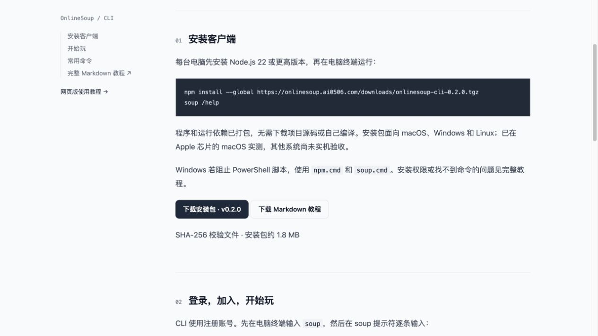
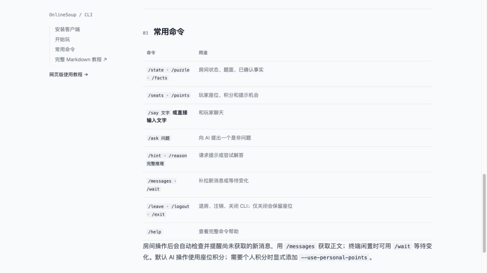

# OnlineSoup CLI 网站安装包验收

日期：2026-10-09。版本：0.2.0。代码提交：`f070888`。

## 发布结果

- 下载页：<https://onlinesoup.ai0506.com/cli>。
- 安装包：<https://onlinesoup.ai0506.com/downloads/onlinesoup-cli-0.2.0.tgz>。
- 玩家教程：<https://onlinesoup.ai0506.com/downloads/OnlineSoup-CLI-Guide.md>，唯一编辑源 `cli/PLAYER_GUIDE.md`；发布脚本复制网站副本，检查脚本比对内容。
- SHA-256：`4b2aed821dd42a7f55e2bdfefd614ac72fe3a61376bd77e75183ad218744ba30`，1,845,326 字节。
- Vercel：`dpl_ZKwAXUYMAxJzFgfyZCwWZKK8kDqe`，状态 READY，已绑定生产域名；部署源为提交的独立归档。

## 验证

| 检查 | 结果 |
| --- | --- |
| 根项目 typecheck / build | 通过，新增 `/cli` 编译正常 |
| lint | 0 错误，3 条已有的页面导航 warning |
| CLI / 根项目测试 | 13 / 4 项通过 |
| `npm run cli:package` 连续生成 | 两次字节和 SHA-256 一致；从 lockfile 安装，打包文件白名单检查通过 |
| `npm run cli:check-package` | 空安装目录、空 npm 缓存、离线安装成功；实际生成的 soup 命令执行 JSON `/help` 与 `/exit` 成功，验证共享协议和原生文件锁可用 |
| `npm run cli:check-package -- --production` | 线上发布清单、安装包哈希、校验文件和 Markdown 与本地完全一致；下载的包离线安装运行成功 |
| 教程中的原样 npm 安装 URL | 在另一空目录、空缓存中直接 `npm install --global --prefix 临时目录 https://onlinesoup.ai0506.com/downloads/onlinesoup-cli-0.2.0.tgz` 成功，离开项目目录运行 soup 成功 |
| 网站入口 | 未登录 GET `/cli`、`/tutorial`、`/docs` 均 200，后两者有 CLI 链接；浏览器真实打开生产下载页 |
| 浏览器下载按钮 | 两个按钮均实际下载成功；安装包哈希、教程内容与仓库源一致 |
| 登录代理匹配 | 使用当前 Next 安装版本的 matcher 编译器验证：`/downloads/` 三种文件不经过代理，`/cli`、管理员、房间和 API 路径仍匹配；CLI 教程与现有教程一样允许未设置用户名的账号阅读 |
| 跨平台原生依赖 | 包内保留 darwin / linux / win32 的 x64、arm64 `.node` 预编译文件和依赖许可证 |

实际安装环境：macOS arm64，Node.js 24.16.0。Windows / Linux / Intel Mac / Node.js 22 尚未实机验收；不能把文件存在视作这些系统已运行通过。不同系统的安装与 PowerShell 脚本限制处理方式已写入指南。

本次只新增客户端分发和教程入口，未修改玩家 API 或数据库，没有新迁移；未重跑真实房间 AI 付费流程和数据库测试。已部署的浏览器登录与游戏能力详见此前对应验收记录。本次未推送 GitHub。

验证没有安装到用户的全局 npm 目录，临时安装与构建归档已清理；仅保留用户可用的 Downloads 安装包和 Markdown。未创建/接管房间或修改测试账号。

## 后续发版

先更新 CLI 版本、lockfile 和玩家指南里的版本 URL，再运行 `npm run cli:package`、`npm run cli:check-package`，提交生成文件并部署；最后执行 `npm run cli:check-package -- --production`。同版本不同字节的包会被拒绝覆盖；旧版文件保留以免安装链接失效。

## 0.2.1 文档补丁验收

代码提交 `0af3cc4`；生产部署 `dpl_FAJVNrGRoAARxXjLDTqoQAyehAYb` READY。新增网站玩法教程链接、纯终端账号/邮箱隐藏密码登录章节，以及与 `--no-browser` 的区别。8 个运行模块与 0.2.0 字节一致，无登录逻辑变化。

根 typecheck/build、lint（0 错误/3 旧 warning）及本地/生产 `cli:check-package` 通过；生产四种文件与本地一致，新包独立离线安装运行成功，旧 0.2.0 URL 仍可用，教程 /tutorial 返回 200。网站指南和包内指南均包含新增内容。未重跑线上账号密码登录或房间付费流程，未推送 GitHub。

## 0.3.0 操作后消息提醒验收

日期：2026-10-10。代码提交 `83cd481`；生产部署 `dpl_9fWjcfuNZNzC3opc4NCbAw1iurPM` READY。

- 房间联网操作后通过既有成员鉴权 messages GET 检查，最多约 2 秒、无重试。文本提醒或 JSON `message_check`。
- 检查不修改同步游标或缓存正文；写入响应中的本人消息/AI 回答 ID 单独保留最近 200 个，减少重复提醒；不承诺终端恰好一次显示。
- 初次仅检查最新一页；若仍有分页、等待事务可见或检查失败则返回未知，不声称没有新消息。游标过期提示显式 `/messages --reset`。
- 原命令的成功/失败、请求键、pending 和退出码不受检查结果影响。退出房间或本地命令不额外请求，messages/wait 本身已获取消息。
- 18 项 CLI 测试、4 项根测试、typecheck/build、lint（0 错误/3 旧 warning）及本地/生产独立安装检查通过。
- 从真实生产 npm URL 安装到空目录/缓存后，使用安装后的程序重复实进程 HTTP 验证：ask/reason/hint/chat/state/puzzle/facts/seats/points 各附带一次检查，只有一行 JSON，游标和正文缓存不推进；写入 504 时保持退出码 5 和 pending，即便检查返回设备接管错误。
- 生产未登录消息检查仍返回 401 / LOGIN_REQUIRED；浏览器生产页含新说明，指南与安装包均已更新。

本次未改数据库或服务端 API；受控 HTTP 流程不等同于真实房间、网页与 AI 的生产 E2E，本次没有创建、接管或付费操作真实房间。macOS arm64 Node24 实测，其他平台未实机验收。未推送 GitHub。

