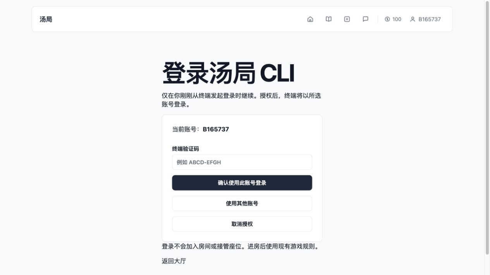

# CLI 浏览器登录验收

日期：2026-10-09。状态：已实现、迁移并部署生产，真实浏览器与 CLI 互通验证通过。

## 2026-10-12 其他账号授权隔离修复（已发布）

- 原实现“使用其他账号”调用 Cookie 客户端的 `signInWithPassword`，会将网页账号也切换。下文 10-09 的“网页 session 保留”仅能覆盖直接确认当前账号，不能作为切换账号不影响网页的证据。
- 现在其他账号／未登录表单同时收集账号、密码和终端验证码，点击“确认使用此账号登录 CLI”后，在服务端使用公开 key 的非持久化 Auth 客户端验证密码，并以该账号的真实 authenticated session 调用原授权 RPC。登录凭证不返回浏览器、不写网页 Cookie；当前网页账号确认与取消路径保留。
- 验证码、原 CLI 账号约束、有效期、真实 Auth session 检查仍由既有 RPC 执行，权限及表结构无变化。授权失败退出本次临时 Auth session；成功时不能立即退出，因为后续 CLI 发行还会核验批准者 session 存在。
- 本地生产构建 + 真实 Supabase HTTP 流程：网页账号 A（测试账号）保持登录 → 使用账号 B 的用户名、密码及终端验证码提交实际 Server Action 表单 → approved → CLI poll 收到账号 B → `/session` 核对 user_id → ack → logout。检查授权响应没有 Supabase Auth Set-Cookie、网页原 Cookie 保持且仍识别账号 A。临时账号按管理端清理 RPC 与 Auth 删除顺序清理，未加入房间。
- 新增 10 项隔离回归，全部 19 项单元测试、typecheck、build 通过；lint 0 错误、3 条既有警告。生产部署后，主域名实际 Server Action 表单 → 批准 → CLI 收取、/session核对 → ack/logout 全流程通过，网页原账号保留且授权响应没有覆盖网页 Auth Cookie。部署 dpl_AQbxRWDcag4JsUDdvUabPSSi9Tku；未推送 GitHub，未做真实浏览器点击验收。

## 使用

终端运行 `/login`，自动打开 `/auth/cli?id=...`。网页显示当前账号，可以输入终端验证码确认；选择其他账号或网页未登录时，在同一表单输入账号、密码和终端的 8 位验证码，再明确授权 CLI。网页原账号保持不变，未登录的网页也不会因此登录。完成后返回终端，不自动加入或接管房间。`/login 用户名` 的隐藏密码输入保留。

非桌面/Agent 可运行 `soup --json /login` 获取 verification_uri 与 user_code，由操作者确认后 `soup --json /login --wait`。`--no-browser` 禁止自动打开，Ctrl+C 后可恢复未过期请求。

## 边界与实现

- 每次请求具有 256 位 device secret 与独立 verifier（SHA256 challenge）。URL 只含随机 UUID，秘密不进入 URL、stdout 或日志；短验证码单独在终端显示，网页必须手动输入，最多 5 次错误。
- 受限 authenticated RPC 再验真实网页 Auth session、当前账号及原 CLI 账号约束；CLI 会话/匿名角色不能批准。开始/密码尝试复用每 IP 哈希 10 分钟 10 次限流，不记录原始 IP。
- 私有 soup_cli.browser_logins 表启用 RLS，撤销所有公开角色及 service_role 直接表访问，服务端只经最小 RPC。发行 RPC 仅 service_role，批准 RPC 仅 authenticated。无浏览器可读凭证表。
- 授权有效 5 分钟；单发行者在批准后为已存在用户生成并消费 Supabase magic link（不发邮件、不向客户端返回链接/令牌），建立独立 Auth session 并登记为 CLI。网页 session 保留。发行前与保存前检查批准者会话仍存在。
- AES-256-GCM 将暂存会话绑定请求 id。响应 Cookie 丢失后，相同证明重取同一会话；CLI 原子保存 Cookie/账号后 ack，服务端清空密文。过期调用会清空，新开始清理过期行；未调用的过期行可能保留至下一次开始，但不能再兑换。
- 替换已有 CLI 登录前重复检查活动座位，经原 player_revoke_session 事务拒绝并发加入后撤销旧登记与旧 Auth 会话。认证失效且仍记录房间时，只允许原账号恢复。登录不修改座位、积分或网页接管规则。
- 发行进程失败或租约 60 秒未完成时不会再次发行相同请求，需重新授权。CLI 保留可恢复的网络未知状态，但清理确定失败的本地待授权记录。Server secret 轮换使尚未收取的密文失效。

## 验证

- 新迁移 `20261009150856_cli_browser_login` 已部署并按真实版本补档。回读角色：anon/authenticated 不能调用发行 RPC，service_role 可调用；authenticated 可调用批准 RPC。
- 空白 PostgreSQL 18.4 全量迁移重放通过（Auth/Realtime 替身，排除 pg_cron）。新增 8 项数据库行为验证最小权限、未授权与错误 proof、账号变化/原账号约束、5 次错误码拒绝、单发行者与 ack 清除、取消/过期、发行超时、CLI/撤销网页会话拒绝；P0/P1/P2 49 项回归通过，共 57 项。
- CLI 13 项行为通过，其中新增 JSON 两阶段登录、秘密不输出、未知响应重试、Cookie 与账号保存后才 ack；原密码输入与进程锁测试保留。根单测 4 项、typecheck、lint（0 错误/3 条旧警告）、build 通过。
- 本地网页 + 真实 Supabase：网页已登录时切换到专用测试账号、输入密码、返回账号确认、验证码批准、CLI 正确登录；再次取消返回 BROWSER_LOGIN_CANCELLED，原 CLI 登录保持。
- 生产域名：未登录表单 → 专用账号网页登录 → 确认；故意不保存首次发行响应中的 Set-Cookie，再用原授权从真实 CLI 重试，成功收取同一授权并继续 /session；生产已登录网页再次直接确认成功，替换旧 CLI 后仅一个活动 CLI 登记、一个旧登记已撤销，网页登录保持。回读 consumed、ciphertext=NULL、网页会话仍有效、独立 CLI 会话存在。
- Mac 浏览器实际 UI 与服务器登录已验证；自动调用系统默认浏览器的跨平台行为及 Windows/Linux 未实测，均保留手动链接入口。

## 安全 Advisor

对比迁移前后的结果只有本次设计预期的两项提示：[私有表 RLS 无 policy](https://supabase.com/docs/guides/database/database-linter?lint=0008_rls_enabled_no_policy)（表完全拒绝直连，RPC 访问）与 [authenticated SECURITY DEFINER RPC](https://supabase.com/docs/guides/database/database-linter?lint=0029_authenticated_security_definer_function_executable)（受限授权入口，空 search_path、真实会话/账号/验证码校验）。没有新增匿名可调用发行函数，不为消除提示开放表权限。

## 发布与清理

代码提交 f873776，UI/失败恢复提交 8a09e84；Supabase 迁移与 Vercel 发布分别记录。最终 Vercel 部署 `dpl_2aodU8tJT8WLWjn7JPAPYwUPgNXY` 为 READY，别名 `https://onlinesoup.ai0506.com`。本次未推送 GitHub。

临时测试账号仅用于本次授权验收，未创建或接管房间；验收后按原管理入口清理账号与关联记录，退出 CLI/网页、删除本地会话与独立发布目录。
